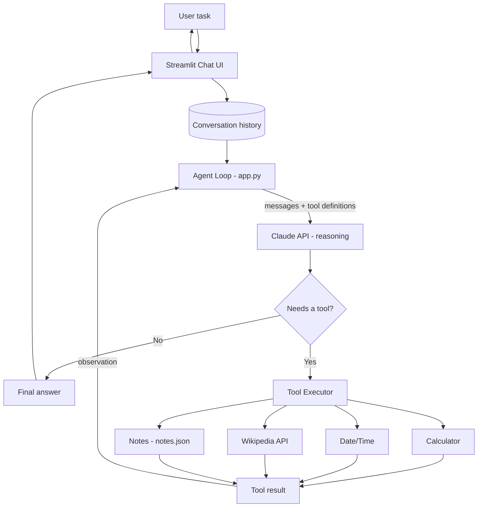

# Schema of the Agentic AI Agent

## Architecture



## Agent loop (Think → Act → Observe)
1. **Think** – Claude reads the task and chooses an action
2. **Act** – the chosen tool is executed
3. **Observe** – the result is fed back to Claude
4. Repeat until Claude returns a final answer (max 6 steps)

## Components
| Component | Role |
|---|---|
| Streamlit UI | Input box, chat display, shows tool calls |
| Agent loop | Controls the think-act-observe cycle |
| Claude API | Reasoning and tool selection |
| Tool executor | Runs the selected Python tool |
| Tools | calculator, get_datetime, wikipedia_summary, save_note, list_notes |
| Storage | `notes.json` for persistent notes |

## Tool schema (example)
```json
{
  "name": "calculator",
  "description": "Evaluate a math expression",
  "input_schema": {
    "type": "object",
    "properties": {"expression": {"type": "string"}},
    "required": ["expression"]
  }
}
```
